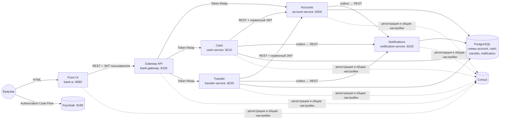

# Микросервисное приложение «Банк»

Веб-приложение, в котором клиент банка после входа через Keycloak может:

- редактировать данные своего аккаунта (фамилию и имя, дату рождения) — с проверкой, что все поля заполнены и возраст старше 18 лет;
- класть виртуальные деньги на свой счёт и снимать их;
- переводить деньги на счёт другого клиента.

Обо всех операциях отправляются уведомления (сохраняются в БД и пишутся в лог сервиса Notifications).

## Содержание

- [Архитектура](#архитектура)
- [Безопасность и права доступа](#безопасность-и-права-доступа)
- [Технологии](#технологии)
- [Структура проекта](#структура-проекта)
- [Сборка](#сборка)
- [Запуск в Docker](#запуск-в-docker)
- [Запуск локально (в среде разработки)](#запуск-локально-в-среде-разработки)
- [Тесты](#тесты)
- [Конфигурация](#конфигурация)

## Архитектура



| Приложение | Порт | Назначение |
|---|---|---|
| `bank-ui` | 8080 | Фронт на Spring Web MVC + Thymeleaf, вход через Keycloak (Authorization Code Flow + PKCE) |
| `bank-gateway` | 8100 | Gateway API на Spring Cloud Gateway (WebFlux): маршрутизация через Service Discovery и проброс JWT пользователя |
| `account-service` | 8200 | Аккаунты и счета: логин, фамилия и имя, дата рождения, баланс |
| `cash-service` | 8210 | Пополнение счёта и снятие денег |
| `notification-service` | 8220 | Приём и хранение уведомлений |
| `transfer-service` | 8230 | Переводы между счетами |
| Consul | 8500 | Service Discovery и Externalized Config (KV) |
| Keycloak | 8180 | Сервер авторизации OAuth 2.0 / OpenID Connect |
| PostgreSQL | 5432 | Одна БД `postgres`, у каждого сервиса своя схема |

### Взаимодействие

- Фронт ходит в микросервисы только через Gateway API. Gateway — resource server: проверяет JWT и пробрасывает его в сервисы (`JwtTokenRelay`).
- Микросервисы вызывают друг друга напрямую по имени из Consul (`lb://`, Spring Cloud LoadBalancer) с токеном, полученным по Client Credentials Flow.
- Cash и Transfer меняют баланс через внутренний API Accounts (`/account/internal/**`). Перевод выполняется в Accounts одной транзакцией с блокировкой строк в фиксированном порядке (без дедлоков при встречных переводах).
- Пользователь видит сумму только на своём счёте: логин всегда берётся из JWT, а список других аккаунтов содержит только логин и имя.

### Паттерны

| Паттерн | Реализация |
|---|---|
| Gateway API | `bank-gateway` на Spring Cloud Gateway |
| Service Discovery | Consul + `spring-cloud-starter-consul-discovery`, клиентская балансировка Spring Cloud LoadBalancer |
| Externalized / Distributed Config | Consul KV (`config/application/data`) + `spring-cloud-starter-consul-config` |
| Access Token | JWT Keycloak: Authorization Code Flow для фронта, Client Credentials Flow для сервисов, Token Relay в Gateway |
| Database per Service | одна БД PostgreSQL, отдельная схема и миграции Flyway у каждого сервиса |
| Circuit Breaker | Spring Cloud Circuit Breaker + Resilience4j на вызовах Accounts и Notifications; бизнес-отказы (4xx) не размыкают цепь |
| Retry | `PingListener` проверяет зависимости после старта с экспоненциальной задержкой (Resilience4j Retry) и не роняет приложение |
| Transactional Outbox | уведомление сохраняется в `notification_outbox` в той же транзакции, что и операция; `NotificationOutboxPublisher` доставляет их (`FOR UPDATE SKIP LOCKED`, at-least-once) |
| UI Composition | страница собирается из ответов Accounts, Cash и Transfer; ошибка одного блока не мешает показать остальные |
| Contract Testing | Spring Cloud Contract: контракты producer-ов и consumer-тесты клиентов на stub-ах |
| Single Service per Host | каждое приложение — отдельный Docker-контейнер со своим портом |

## Безопасность и права доступа

Привилегии передаются в JWT как realm-роли Keycloak (claim `realm_access.roles`), логин — в claim `preferred_username`.

| Роль | Смысл |
|---|---|
| `ROLE_USER` | клиент банка |
| `ROLE_SERVICE` | микросервис (Client Credentials) |
| `ACCESS_ACCOUNTS`, `ACCESS_CASH`, `ACCESS_TRANSFER`, `ACCESS_NOTIFICATIONS` | доступ к соответствующему сервису |

| Субъект | Роли в токене |
|---|---|
| Пользователь (группа `bank-clients`, в неё попадают и новые зарегистрированные пользователи) | `ROLE_USER`, `ACCESS_ACCOUNTS`, `ACCESS_CASH`, `ACCESS_TRANSFER` |
| `account-service` | `ROLE_SERVICE`, `ACCESS_NOTIFICATIONS` |
| `cash-service` | `ROLE_SERVICE`, `ACCESS_ACCOUNTS`, `ACCESS_NOTIFICATIONS` |
| `transfer-service` | `ROLE_SERVICE`, `ACCESS_ACCOUNTS`, `ACCESS_NOTIFICATIONS` |

| Endpoint | Требуется |
|---|---|
| `GET/PUT /account/me`, `GET /account/others` | `ROLE_USER` + `ACCESS_ACCOUNTS` |
| `POST /account/internal/**` | `ROLE_SERVICE` + `ACCESS_ACCOUNTS` |
| `POST /cash/deposit`, `POST /cash/withdraw` | `ROLE_USER` + `ACCESS_CASH` |
| `POST /transfer` | `ROLE_USER` + `ACCESS_TRANSFER` |
| `POST /notifications` | `ROLE_SERVICE` + `ACCESS_NOTIFICATIONS` |

Так, например, Cash не может вызвать Transfer, а пользователь не может напрямую изменить свой баланс через `/account/internal`.

Выход из фронта завершает и сессию в Keycloak (RP-Initiated Logout).

### Тестовые пользователи

Realm `bank-realm` импортируется из [`keycloak/realms/bank-realm.json`](keycloak/realms/bank-realm.json) при первом запуске Keycloak.

| Логин | Пароль | Аккаунт |
|---|---|---|
| `ivanov` | `password` | Иванов Иван, 1000 руб. |
| `petrov` | `password` | Петров Петр, 500 руб. |
| `sidorov` | `password` | Сидоров Сидор, 300 руб. |

Новые пользователи могут зарегистрироваться на странице входа Keycloak; аккаунт в Accounts создаётся при первом входе.

Консоль администратора Keycloak: <http://localhost:8180/admin> (`admin` / `admin`).

## Технологии

Java 21, Gradle (мультипроект), Spring Boot 4.2, Spring Cloud 2026.0 (Gateway, Consul Discovery и Config, LoadBalancer, Circuit Breaker), Spring Security OAuth2 (client, resource server), Spring Data JPA + Hibernate, Flyway, PostgreSQL 15, Keycloak 22, Resilience4j, Thymeleaf, JUnit 5, Spring Boot Test, Testcontainers, Spring Cloud Contract 5.0, Docker Compose.

## Структура проекта

```
bank-microservice-app/
├── build.gradle.kts / settings.gradle.kts   # родительский проект и общие зависимости
├── bank-ui/                                 # фронт
├── bank-gateway/                            # Gateway API
├── account-service/
├── cash-service/
├── transfer-service/
├── notification-service/
├── consul/kv/application.yaml               # общие настройки, загружаемые в Consul KV
├── keycloak/realms/bank-realm.json          # realm Keycloak
└── docker-compose.yaml
```

Слои внутри сервиса (на примере `account-service`):

```
ru.practicum.account
├── web.controller     # REST-контроллеры
├── web.dto            # запросы и ответы API
├── web.handler        # обработка ошибок (ProblemDetail)
├── service            # бизнес-логика, публикатор outbox
├── repository         # Spring Data JPA (DAO)
├── model              # JPA-сущности
├── client             # REST-клиенты других сервисов
├── config             # RestClient, Circuit Breaker
├── security           # SecurityFilterChain, конвертер JWT → роли
└── listener           # проверка доступности зависимостей при старте
```

Во фронте дополнительно есть слой view — шаблон `templates/main.html`.

## Сборка

Нужны JDK 21 и Docker (для тестов на Testcontainers). Сборка всех модулей и прогон всех тестов одной командой:

```bash
./gradlew build
```

Только executable JAR-файлы (`<модуль>/build/libs/<модуль>.jar`):

```bash
./gradlew bootJar
```

## Запуск в Docker

```bash
./gradlew bootJar
docker compose --profile apps up -d --build
```

После того как все контейнеры станут `healthy` (`docker compose --profile apps ps`), откройте <http://localhost:8080> и войдите под тестовым пользователем.

Остановка: `docker compose --profile apps down` (данные сохраняются в volume; `down -v` удалит и их).

Отдельное приложение можно собрать и запустить вручную, например:

```bash
docker build -t bank/account-service account-service
docker run --network bank-microservice-app_default -p 8200:8200 \
  -e CONSUL_HOST=consul-server -e DB_HOST=postgres-db \
  -e KEYCLOAK_PUBLIC_URL=http://localhost:8180 -e KEYCLOAK_INTERNAL_URL=http://keycloak:8080 \
  bank/account-service
```

## Запуск локально (в среде разработки)

1. Поднять инфраструктуру (Consul, PostgreSQL, Keycloak) и загрузить общие настройки в Consul:

   ```bash
   docker compose up -d
   ```

2. Запустить приложения из IDE или командами:

   ```bash
   ./gradlew :notification-service:bootRun
   ./gradlew :account-service:bootRun
   ./gradlew :cash-service:bootRun
   ./gradlew :transfer-service:bootRun
   ./gradlew :bank-gateway:bootRun
   ./gradlew :bank-ui:bootRun
   ```

   Порядок запуска не важен: `PingListener` дождётся зависимостей, а уведомления накопятся в outbox до появления Notifications.

3. Открыть <http://localhost:8080>.

## Тесты

| Вид | Где | Что проверяют |
|---|---|---|
| Юнит | `src/test`, JUnit 5 + Mockito | бизнес-логика сервисов, валидация возраста, конвертер JWT, outbox-публикатор, Circuit Breaker клиента Accounts, фильтр проброса токена, обработчик выхода |
| Интеграционные | `src/test`, Spring Boot Test + MockMvc / WebTestClient + Testcontainers PostgreSQL | REST API с реальной БД и миграциями, права доступа для токенов пользователя и сервисов, записи в outbox, маршрутизация Gateway с пробросом JWT |
| Контрактные (producer) | `src/contractTest`, Spring Cloud Contract | соответствие API сервисов контрактам из `src/contractTest/resources/contracts` |
| Контрактные (consumer) | `*ContractTest` в `src/test`, Stub Runner | REST-клиенты против stub-ов, сгенерированных из контрактов producer-ов |

Интеграционные тесты одного модуля используют общий базовый класс с одинаковой конфигурацией, поэтому TestContext Framework кеширует контекст и контейнер PostgreSQL между тестовыми классами.

Контракты:

| Producer | Контракты | Consumer |
|---|---|---|
| `notification-service` | отправка уведомления | account, cash, transfer |
| `account-service` | `/account/me`, `/account/others`, `/account/internal/**` | cash, transfer, bank-ui |
| `cash-service` | `/cash/deposit`, `/cash/withdraw` | bank-ui |
| `transfer-service` | `/transfer` | bank-ui |

Запуск:

```bash
./gradlew test            # юнит, интеграционные и consumer-тесты
./gradlew contractTest    # тесты producer-ов, сгенерированные из контрактов
./gradlew check           # всё вместе
```

## Конфигурация

Общие для всех приложений настройки лежат в [`consul/kv/application.yaml`](consul/kv/application.yaml) и загружаются в Consul KV (`config/application/data`) контейнером `consul-kv-initializer`. После изменения файла: `docker compose up -d consul-kv-initializer`.

Специфичные настройки (порт, схема БД, client id/secret, маршруты Gateway) — в `application.yaml` каждого модуля.

Переменные окружения:

| Переменная | По умолчанию | Назначение |
|---|---|---|
| `CONSUL_HOST`, `CONSUL_PORT` | `localhost`, `8500` | адрес Consul |
| `DB_HOST`, `DB_PORT`, `DB_NAME` | `localhost`, `5432`, `postgres` | адрес PostgreSQL |
| `DB_USERNAME`, `DB_PASSWORD` | `postgres`, `password` | учётные данные БД |
| `KEYCLOAK_PUBLIC_URL` | `http://localhost:8180` | адрес Keycloak для браузера и значение claim `iss` |
| `KEYCLOAK_INTERNAL_URL` | `http://localhost:8180` | адрес Keycloak для приложений (в Docker — `http://keycloak:8080`) |
